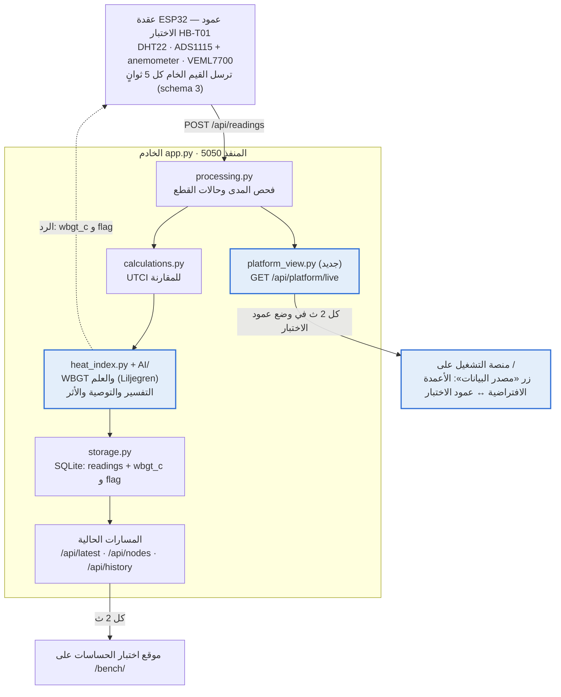

# دليل دمج موقع هبوب

14 أكتوبر 2026 · سارة العنزي

موقع واحد يشغّله خادم Python واحد على المنفذ 5050: منصة التشغيل على `/`، وموقع اختبار الحساسات على `/bench/`، وكلاهما يقرأ قراءات ESP32 نفسها بعد أن تحسب وحدة الذكاء الاصطناعي مؤشر WBGT وعلمه. زر في الشريط العلوي يبدّل المنصة بين الأعمدة الافتراضية (بيانات العرض) وعمود الاختبار (العقدة الحقيقية).

## بطاقة الوثيقة

| البند | القيمة |
| --- | --- |
| النوع | دليل تكامل تقني (Integration Guide) |
| المشروع | هبوب — تحدي إكسبو 2030 الرياض 2.3 |
| القالب | لا يوجد قالب رسمي لهذا النوع؛ هيكل مقترح |
| الجمهور | من يبرمج الموقع، ثم ريناد (AI)، وريم وريفان (الواجهات)، ولينا وسارة (العقدة) |
| الإصدار | 1.2 · 14 أكتوبر 2026 |
| الحالة | مسودة للمراجعة |
| الكود | المجلد `HABOOB` داخل «مشروع هاكثون اكسبو ٢٠٣٠» على سطح المكتب: كل الأكواد مدمجة وجاهزة للتشغيل، وهذه الوثيقة بداخله بصيغة Markdown |

**ثلاثة قرارات تبني عليها الوثيقة:**

1. **المؤشر الرئيسي WBGT لا UTCI.** هذا قرار دليل علم البيانات v3 ووثيقة UX-UI v2. الخادم يبقي UTCI محسوبًا للمقارنة فقط.
2. **خادم واحد ومنفذ واحد (5050).** الخادم الحالي `app.py` يبقى كما هو بلا إطار جديد، ويُضاف إليه ما يلزم فقط. لا يُبنى خادم ثانٍ داخل مجلد AI.
3. **وحدة الذكاء الاصطناعي تُستدعى ولا تُعاد كتابتها.** دالة ريناد `process_reading` تُستدعى من الخادم لكل رسالة، بمعاملات المعايرة الموجودة في `config.json` الرئيسي.

**حالة الكود في مجلد HABOOB:** شغّلته كاملًا في بيئة اختبار سحابية بلا عتاد: الخادم برسائل بصيغة schema 3 وبوضع المحاكاة، والمنصة في متصفح محاكى (jsdom) مع زر التبديل في الاتجاهين. لم يُجرَّب بعد على لابتوب الفريق ولا مع العقدة الحقيقية.

## الوضع الحالي والتعارضات

الأجزاء الأربعة تعمل كل منها وحده، لكنها لا تتكلم لغة واحدة: الخادم والمنصة على UTCI، ووحدة الذكاء الاصطناعي على WBGT، والمنصة لا تقرأ من الخادم إطلاقًا.

| الجزء | المكان على سطح المكتب | الحالة | ما ينقصه للدمج |
| --- | --- | --- | --- |
| برنامج العقدة `sensor_node.ino` (0.3.0) | `ESP32 Project Codes/01_firmware_esp32` | يرسل schema 3 كل 5 ث؛ DHT22 يعمل، وI2C لم يُكتشف حتى 11 أكتوبر | يقرأ `utci_c` و`stress_key` من الرد؛ يحتاج `wbgt_c` و`flag` |
| الخادم `app.py` | `ESP32 Project Codes/02_server_backend` | يستقبل ويخزن ويحسب UTCI، وفيه وضعا العتاد والمحاكاة | لا يحسب WBGT، ولا يقدم المنصة |
| وحدة الذكاء الاصطناعي `HABOOB_AI` | `Codes/HABOOB_AI (2).zip` | تحسب WBGT بطريقة Liljegren والأعلام الخمسة؛ اختباراتها الخمسة تنجح | لا يستدعيها أحد؛ لا تفسير ولا توصية |
| منصة التشغيل v2 | `ux:ui/HABOOB_Smart_Outdoor_Operations_v2.html` | 24 منطقة و36 عمودًا ببيانات وهمية | على UTCI؛ لا اتصال بالخادم |
| موقع اختبار الحساسات | `ESP32 Project Codes/04_dashboard_web` | لوحة تشخيص لكل قطعة | يبقى كما هو على `/bench/` |

ملاحظة: `Codes/ESP32 Project Codes copy` نسخة مطابقة حرفيًا للمجلد الأصلي (فحصتها بالمقارنة). المصدر المعتمد في هذه الوثيقة هو `ESP32 Project Codes`.

### التعارضات وحلها

| # | التعارض | أثره | الحل في هذه الوثيقة |
| --- | --- | --- | --- |
| T1 | الخادم والمنصة على UTCI، والدليل v3 ووحدة AI على WBGT | قيم وأعلام مختلفة على الشاشة نفسها | WBGT هو المعروض والملوِّن؛ UTCI يبقى في البيانات للمقارنة |
| T2 | ربط الأعلام الخمسة بحالات المنصة الأربع مختلف بين الوثيقتين | لون المنطقة يتغير حسب الوثيقة المتبعة | ثابت واحد `FLAG_ST` في الواجهة؛ اعتمدت مؤقتًا ربط وثيقة UX (انظر القسم الأخير) |
| T3 | معاملات الرياح في `AI/config.json` وفي `config.json` الرئيسي، ونقطة المعايرة تعدّل الثاني فقط | المعايرة من اللوحة لا تصل إلى WBGT | الخادم يمرر معاملات العقدة إلى الدالة في كل رسالة |
| T4 | غياب مكتبة thermofeel يرمي خطأ لا تلتقطه وحدة AI | الخادم يرفض الرسالة كلها بخطأ 500 ولا يحفظها | الجسر يلتقط الخطأ ويعود للصيغة الاحتياطية مع ملاحظة |
| T5 | وحدة AI تقرأ الحالة من رسالة العقدة الخام | قيمة رفضها الخادم (خارج المدى) قد تدخل الحساب | الجسر يمرر حالات القطع بعد فحص الخادم |
| T6 | المنفذ 5000 في `config.json` و5050 في العقدة وفي نوشن | الخادم يبدأ على منفذ لا تعرفه العقدة إن نُسي `--port` | المنفذ 5050 في `config.json` |
| T7 | العمود «غير متصل» بعد 15 ث في الخادم و5 دقائق في وثيقتي UX وDS | حالة العمود تختلف بين الموقعين | أبقيت 15 ث للعرض؛ قرار مفتوح |

## المعمارية الموحدة



المربعات الملوّنة هي الجديد: الجسر مع وحدة AI، ومسار المنصة، والمنصة نفسها. كل ما عداها موجود اليوم ويبقى كما هو. المنصة في وضع «الأعمدة الافتراضية» لا تطلب من الخادم شيئًا، فتعمل حتى لو فُتح الملف من القرص.

## هيكل المجلدات الموحد

كل الأكواد الآن في مجلد واحد `HABOOB` بجانب `ESP32 Project Codes` (الأصل باقٍ كما هو للرجوع). المجلد هو جذر الموقع، ويُرفع كما هو إلى مستودع GitHub:

```text
HABOOB/
├── README.md                   ← التشغيل وخريطة المجلدات
├── دليل_دمج_موقع_هبوب.md       ← هذه الوثيقة
├── config.json                 ← الإعدادات الوحيدة (المنفذ 5050 + قسم platform)
├── requirements.txt            ← thermofeel وpythermalcomfort وpyserial
├── .gitignore                  ← data/ و__pycache__/ و.venv/ وsecrets.h
├── 01_firmware_esp32/
│   └── sensor_node/
│       ├── sensor_node.ino     ← الإصدار 0.4.0 (القسم 9)
│       ├── secrets.example.h   ← قالب اسم الهوتسبوت وكلمة المرور
│       └── secrets.h           ← القيم الفعلية، على اللابتوب فقط
├── 02_server_backend/
│   ├── app.py, processing.py, storage.py              ← معدّلة
│   ├── heat_index.py           ← جديد: الجسر مع وحدة AI
│   ├── platform_view.py        ← جديد: GET /api/platform/live
│   └── calculations.py, settings.py, simulator.py     ← كما هي
├── AI/                         ← وحدة ريناد + advice.py الجديد
├── tests/                      ← اختبارات وحدة AI
├── web/
│   ├── index.html              ← منصة UX/UI v2 بعد التحويل إلى WBGT
│   ├── js/live.js              ← جديد: زر مصدر البيانات
│   └── bench/                  ← موقع اختبار الحساسات (كان 04_dashboard_web)
├── 03_usb_bridge/              ← كما هو
├── 05_docs/                    ← كما هو
└── 06_tools/
    ├── acceptance_test.py      ← معدّل (القسم 10.3)
    ├── send_test_message.py, i2c_test/, pin_test/     ← كما هي
    └── wokwi_sim/              ← محاكاة Wokwi القديمة على UTCI، للرجوع فقط
```

ما لم يُنقل: `data/readings.db` (القاعدة تُنشأ من جديد عند أول تشغيل، والقديمة باقية في `ESP32 Project Codes`)، ومجلد `.venv` الموجود داخل ملف ZIP لوحدة AI (بيئة ويندوز لا تعمل على الماك).

كلمة مرور الهوتسبوت انتقلت من `sensor_node.ino` إلى `secrets.h`، وهو مذكور في `.gitignore`، فلا تُرفع مع الكود.

## الخادم: ربط وحدة الذكاء الاصطناعي

كل رسالة من العقدة تمر بالمسار نفسه: فحص الخادم، ثم UTCI كما هو اليوم، ثم WBGT والعلم والتفسير والتوصية من مجلد `AI`، ثم الحفظ والرد. التعديل كله ملف جديد واحد في الخادم (`heat_index.py`) وملف جديد في AI (`advice.py`) وسطور قليلة في ثلاثة ملفات.

### 5.1 ملف جديد: `02_server_backend/heat_index.py`

```python
"""
جسر الخادم مع وحدة الذكاء الاصطناعي (مجلد AI): حساب WBGT والعلم والتفسير والتوصية.
يُستدعى من processing.process لكل رسالة، بعد فحص المدى وحالات القطع.
"""
import datetime as dt
import os
import sys

ROOT = os.path.dirname(os.path.dirname(os.path.abspath(__file__)))
if ROOT not in sys.path:
    sys.path.insert(0, ROOT)

from AI.pipeline import process_reading, load_config       # noqa: E402
from AI.advice import explain, advise                      # noqa: E402

try:
    import thermofeel  # noqa: F401  — يُستورد مرة واحدة عند تشغيل الخادم
    LILJEGREN_OK, LIB_ERROR = True, ""
except Exception as exc:
    LILJEGREN_OK, LIB_ERROR = False, str(exc)

TZ = dt.timezone(dt.timedelta(hours=3))                    # الرياض
FLAG_AR = {"white": "أبيض", "green": "أخضر", "yellow": "أصفر", "red": "أحمر", "black": "أسود"}
EMPTY = {"wbgt_c": None, "flag": None, "flag_ar": None, "wbgt_method": None,
         "wind_10m_ms": None, "solar_wm2": None, "sun_flag": None,
         "cos_sza": None, "wbgt_reason": None, "explain": None, "advice": None}


def _part(sensors, sid, fields):
    entry = sensors.get(sid) or {}
    out = {"status": entry.get("status")}
    for f in fields:
        out[f] = (entry.get("values") or {}).get(f)
    return out


def _ai_config(nset):
    """config.json في جذر المشروع هو المصدر الوحيد لمعاملات المعايرة (T3)."""
    c = load_config()
    c["wind_k"] = nset.get("wind_k", c["wind_k"])
    c["wind_b"] = nset.get("wind_b", c["wind_b"])
    c["wind_voltage_min"] = nset.get("wind_v_min", c["wind_voltage_min"])
    c["wind_sensor_height_m"] = nset.get("wind_height_m", c["wind_sensor_height_m"])
    return c


def compute(sensors, ts, nset):
    """sensors = حالات القطع بعد معالجة الخادم · ts = وقت القراءة (epoch) · nset = إعدادات العقدة."""
    out = dict(EMPTY)
    c = _ai_config(nset)
    msg = {"sensors": {                                  # الحالات بعد فحص الخادم (T5)
        "dht22": _part(sensors, "dht22", ["ta_c", "rh_pct"]),
        "anemometer": dict(_part(sensors, "anemometer", ["wind_v"]),
                           height_m=c["wind_sensor_height_m"]),
        "veml7700": _part(sensors, "veml7700", ["lux"]),
    }}
    if not LILJEGREN_OK:          # بلا thermofeel: الصيغة الاحتياطية بدل توقف الاستقبال (T4)
        msg["sensors"]["anemometer"]["status"] = "lib_missing"
    try:
        r = process_reading(msg, dt.datetime.fromtimestamp(ts, TZ), c)
    except Exception as exc:      # أي خطأ في الحساب لا يُسقط حفظ الرسالة
        out["wbgt_reason"] = "تعذر حساب WBGT: %s" % exc
        return out

    out.update({"wbgt_c": r.get("wbgt_c"), "flag": r.get("flag"),
                "flag_ar": FLAG_AR.get(r.get("flag")), "wbgt_method": r.get("wbgt_method"),
                "wind_10m_ms": r.get("wind_10m_ms"), "solar_wm2": r.get("solar_radiation_wm2"),
                "sun_flag": r.get("sun_flag"), "cos_sza": r.get("cos_sza")})
    if r.get("reason") == "missing_ta_rh":
        out["wbgt_reason"] = "لا يُحسب WBGT لغياب حرارة الهواء أو الرطوبة."
    elif r.get("reason") == "no_convergence":
        out["wbgt_reason"] = "معادلة WBGT لم تتقارب لهذه المدخلات."
    elif r.get("wbgt_method") == "simple":
        out["wbgt_reason"] = ("قيمة تقريبية بالصيغة الاحتياطية: قراءة الرياح أو الإضاءة غير متوفرة"
                              + ("، ومكتبة thermofeel غير مثبّتة." if not LILJEGREN_OK else "."))

    if r.get("wbgt_method") == "liljegren":           # التفسير والتوصية مع الحساب الكامل فقط
        try:
            fdir = c["direct_radiation_fraction"] if r.get("sun_flag") else 0.0
            args = (r["ta_c"], r["rh_pct"], r["wind_10m_ms"], r["solar_radiation_wm2"],
                    fdir, r["cos_sza"], c["pressure_hpa"])
            contrib = explain(*args)
            out["explain"] = contrib
            out["advice"] = advise(*args, r["flag"], contrib)
        except Exception as exc:
            out["explain_error"] = str(exc)
    return out
```

### 5.2 ملف جديد: `AI/advice.py`

ينفّذ الملحق ب (تفسير السبب) وجدول القواعد 7.2 من دليل علم البيانات v3. كل رقم فيه ناتج من دالة WBGT نفسها بإعادة الحساب بمدخل معدّل.

```python
from .wbgt_calculator import wbgt_liljegren
from .risk_classification import wbgt_flag

SHADE_WM2 = 120.0      # الإشعاع المنتشر المتبقي تحت المظلة (افتراض معلن)
FAN_V10_MS = 3.0       # الرياح على 10 م بعد تشغيل المراوح (افتراض معلن)
FAN_MAX_TA_C = 37.0    # فوقها قد تزيد المراوح الإجهاد في الحر الجاف
LOW_WIND_MS = 1.5      # تحتها تُعد الرياح ضعيفة


def explain(ta, rh, v10, ghi, fdir, cz, p_hpa, v10_ref=FAN_V10_MS):
    """مساهمة كل عامل = WBGT الآن − WBGT والعامل عند قيمته المرجعية."""
    base = wbgt_liljegren(ta, rh, v10, ghi, fdir, cz, p_hpa)
    no_sun = wbgt_liljegren(ta, rh, v10, 0.0, 0.0, cz, p_hpa)
    windy = wbgt_liljegren(ta, rh, max(v10_ref, v10), ghi, fdir, cz, p_hpa)
    return {"wbgt": round(base, 1),
            "radiation": round(base - no_sun, 1) + 0.0,
            "low_wind": round(base - windy, 1) + 0.0}


def advise(ta, rh, v10, ghi, fdir, cz, p_hpa, flag, contrib):
    """جدول القواعد 7.2 + الأثر المتوقع لكل إجراء مقترح."""
    if flag in (None, "white", "green"):
        return {"action": "monitor", "systems": [], "drop_c": 0.0,
                "after_c": contrib["wbgt"], "after_flag": flag}
    base = contrib["wbgt"]
    shade_after = wbgt_liljegren(ta, rh, v10, min(ghi, SHADE_WM2), 0.0, cz, p_hpa)
    fan_after = wbgt_liljegren(ta, rh, max(v10, FAN_V10_MS), ghi, fdir, cz, p_hpa)
    if flag in ("red", "black"):
        systems, after = ["shading", "coolingSys"], shade_after
    elif contrib["radiation"] >= contrib["low_wind"] and contrib["radiation"] > 0.5:
        systems, after = ["shading"], shade_after
    elif v10 < LOW_WIND_MS and ta < FAN_MAX_TA_C:
        systems, after = ["fans"], fan_after
    else:
        systems, after = ["shading"], shade_after
    return {"action": "intervene", "systems": systems,
            "drop_c": round(base - after, 1), "after_c": round(after, 1),
            "after_flag": wbgt_flag(after)}
```

تحقق: رسالة ظهر أكتوبر في الدليل (35 °م، 20%، 0.025 فولت، 88,000 لوكس) أعطت WBGT = 29.1 بعلم أخضر، ومساهمة الإشعاع 6.0 والرياح 1.7. الدليل يذكر 6.1 و1.8؛ الفرق من التقريب قبل الطرح.

### 5.3 `processing.py`: ثلاثة تعديلات

```python
# 1) أعلى الملف
import calculations as ca
import heat_index                      # ← جديد

# 2) داخل process()، قبل سطر: alerts = run_checks(...)
    derived.update(heat_index.compute(sensors, ts, nset))

# 3) داخل run_checks()، قبل «تنبيهات حالات القطع»
    flag = derived.get("flag")
    if flag in ("yellow", "red", "black"):
        sev = "critical" if flag in ("red", "black") else "warning"
        alerts.append(_alert("WBGT-" + flag.upper(), sev,
            "WBGT = %.1f °م (العلم %s)." % (derived["wbgt_c"], derived.get("flag_ar")),
            "التوصية في صفحة المنطقة على المنصة."))
    if derived.get("wbgt_reason"):
        alerts.append(_alert("WBGT-NOTE", "info", derived["wbgt_reason"], None))
```

وفي `nodes_view()` يُضاف `"wbgt_c"` و`"flag"` بجانب `"utci_c"`، وفي `skeleton_view()` تُضاف المفاتيح نفسها بقيمة `None` حتى لا تنكسر المنصة قبل أول رسالة.

### 5.4 `storage.py`: عمودان جديدان بلا حذف البيانات

```python
DERIVED_COLUMNS = ["mrt_c", "v10_ms", "utci_c", "battery_pct", "wbgt_c"]
MIGRATIONS = [("wbgt_c", "REAL"), ("flag", "TEXT")]

# داخل init() بعد executescript(SCHEMA):
        have = {r[1] for r in _conn.execute("PRAGMA table_info(readings)")}
        for col, typ in MIGRATIONS:
            if col not in have:
                _conn.execute("ALTER TABLE readings ADD COLUMN %s %s" % (col, typ))
```

ثم يُضاف `"flag": d.get("flag")` إلى الصف في `save_reading`، و`wbgt_c` إلى استعلام `history()` وقائمة `series`، و`wbgt_c` و`flag` إلى أعمدة `export_csv`. جرّبت الترحيل على قاعدة بالبنية القديمة: أُضيف العمودان وبقيت القراءات.

### 5.5 `app.py`: ستة تعديلات

| المكان | التعديل |
| --- | --- |
| الاستيراد | `import heat_index` و`import platform_view` |
| `WEB_DIR` | `os.path.join(ROOT, "web")` بدل `04_dashboard_web` |
| `do_GET` | مسار جديد: `if path == "/api/platform/live": return self._json(platform_view.live())` |
| رد `_api_readings` | إضافة `"wbgt_c": d.get("wbgt_c")` و`"flag": d.get("flag")` مع إبقاء حقول UTCI للعقدة القديمة |
| `_static` | المجلد يُقدَّم بملف `index.html` بداخله، و`/bench` يُحوَّل إلى `/bench/` (كود أدناه) |
| `/api/health` والشاشة الافتتاحية | سطر حالة thermofeel، ورابطا المنصة وموقع الاختبار |

```python
        target = os.path.normpath(os.path.join(WEB_DIR, rel))
        if target.startswith(WEB_DIR) and os.path.isdir(target):
            if not rel.endswith("/"):            # /bench ← /bench/ حتى تعمل الروابط النسبية
                return self._send(301, b"", "text/plain", {"Location": "/" + rel + "/"})
            target = os.path.join(target, "index.html")
```

### 5.6 `config.json`

```json
"server": { "port": 5050, ... },
"platform": {
  "test_zone":  {"id": "Z", "name": {"ar": "منطقة الاختبار — قاعة طويق", "en": "Test zone — Tuwaiq hall"}},
  "test_poles": {"node-01": {"pole_id": "HB-T01", "zone": "Z"},
                 "sim-01":  {"pole_id": "HB-S01", "zone": "Z"},
                 "sim-02":  {"pole_id": "HB-S02", "zone": "Z"}}
}
```

المعرّف `Z` مقصود: المعرّفات من A إلى X محجوزة لمناطق العرض الأربع والعشرين، و`T` منها هي «البوابة الجنوبية».

عقدة ثانية تُضاف هنا بسطر واحد (`"node-02": {"pole_id": "HB-T02", ...}`) دون أي تعديل في الكود.

## عقد واجهة البرمجة

المنصة تحتاج مسارًا جديدًا واحدًا فقط: `GET /api/platform/live`. بقية المسارات موجودة اليوم ويستخدمها موقع الاختبار، وتغيّر بعضها بإضافة حقول لا بحذفها، فلا ينكسر شيء قائم.

| المسار | الطريقة | من يستخدمه | الحالة | ما تغيّر |
| --- | --- | --- | --- | --- |
| `/api/readings` | POST | العقدة، جسر USB، المحاكاة | معدّل | الرد يضيف `wbgt_c` و`flag` |
| `/api/platform/live` | GET | المنصة (عمود الاختبار) كل 2 ث | جديد | — |
| `/api/history?node=&minutes=` | GET | المنصة (منحنى المنطقة) وموقع الاختبار | معدّل | السلسلة تضيف `wbgt_c` |
| `/api/latest?node=` | GET | موقع الاختبار | معدّل | `derived` يضيف `wbgt_c` و`flag` و`explain` و`advice` |
| `/api/nodes` | GET | موقع الاختبار | معدّل | كل عقدة تضيف `wbgt_c` و`flag` |
| `/api/health` | GET | الفحص قبل العرض | معدّل | يضيف `thermofeel: true/false` |
| `/api/forecast` | GET | المنصة (منحنى التوقع، عمود الاختبار فقط) كل 10 د | جديد | WBGT لـ 10 ساعات قادمة من Open-Meteo؛ بلا إنترنت: `available:false` وسبب، دون ساعات |
| `/api/platform/decision` | POST | المنصة («تفعيل الآن» في عمود الاختبار) | جديد | يسجّل الأنظمة المعتمدة والأثر المتوقع في جدول `decisions`؛ يرجع آخر 5 في `/api/platform/live` |
| `/api/export.csv` | GET | المعايرة والتحليل | معدّل | عمودا `wbgt_c` و`flag` |
| `/api/mode`، `/api/simulation`، `/api/calibration`، `/api/config`، `/api/meta`، `/api/errors` | GET/POST | موقع الاختبار | كما هي | — |

### شكل رد `/api/platform/live`

مختصر من رد فعلي في الاختبار (حرارة 38 °م، رطوبة 25%، رياح صفر، 93,500 لوكس):

```json
{
  "server_mode": "live",
  "index": "wbgt",
  "zone":  { "id": "Z", "name": {"ar": "منطقة الاختبار — قاعة طويق"}, "live": true,
             "temp": 38.0, "hum": 25.0, "wind": 0.0, "solar": 850.0,
             "wbgt": 39.0, "flag": "black", "method": "liljegren",
             "explain": {"wbgt": 39.0, "radiation": 12.4, "low_wind": 6.0},
             "advice":  {"action": "intervene", "systems": ["shading", "coolingSys"],
                         "drop_c": 10.5, "after_c": 28.5, "after_flag": "green"} },
  "poles": [ { "id": "HB-T01", "node_id": "node-01", "zone": "Z", "status": "online",
                "simulated": false, "transport": "wifi", "last_s": 0.1,
                "temp": 38.0, "hum": 25.0, "wind": 0.0, "wind10": 0.0, "solar": 850.0,
                "lux": 93500.0, "wbgt": 39.0, "flag": "black", "utci": 37.7,
                "batt": null, "power": "usb", "sensors": {"dht22": "ok", "...": "..."} } ],
  "alerts": [ { "code": "WBGT-BLACK", "sev": "crit", "type": "heat", "iv": "auto",
                 "target": "HB-T01", "time": "23:26",
                 "title": {"ar": "WBGT = 39.0 °م (العلم أسود)."} } ]
}
```

قواعد الترجمة في الرد:

- **حالة العمود:** `offline` إن لم تصل رسالة منذ 15 ث، و`warning` إن كان متصلًا وفيه قطعة ليست `ok` أو `disabled` أو `assumed`، وإلا `online`.
- **المنطقة:** عمود واحد = منطقة واحدة (قرار الدليل v3). تأخذ قيم أول عمود حقيقي، ولو انقطع تصير قيمها `null` وتظهر «—» (آخر قراءة ليست الحالة الراهنة، وتنبيه WBGT القديم لا يُعرض)؛ وإن لم توجد عقدة حقيقية فأول عقدة محاكاة.
- **التنبيهات:** تنبيهات `WBGT-*` تصبح نوع `heat` بتدخل `auto`، وتنبيهات القطع تصبح `sensor` بتدخل `maint`، وملاحظات الحساب من فئة `info` لا تُنقل إلى المنصة.
- **القيمة الغائبة** تُرسل `null`، ولا تُستبدل برقم (مثل قاعدة DS-02 في عقد البيانات).

### الملف الجديد: `02_server_backend/platform_view.py`

```python
import time

import processing
from settings import cfg, mode

OK_LIKE = {"ok", "disabled", "assumed"}


def _pole_meta(node_id, simulated, index):
    poles = cfg().get("platform", {}).get("test_poles", {})
    meta = poles.get(node_id, {})
    default_id = ("HB-S%02d" if simulated else "HB-T%02d") % (index + 1)
    return meta.get("pole_id", default_id), meta.get("zone", "T")


def _pole_status(view):
    if not view.get("online"):
        return "offline"
    bad = [s for s in view["sensors"].values() if s["status"] not in OK_LIKE]
    return "warning" if bad else "online"


def _alerts(view, pole_id):
    """تنبيهات الخادم بصيغة تنبيهات المنصة (sev / type / iv)."""
    sev_map = {"critical": "crit", "warning": "cau", "info": "info"}
    out = []
    for i, a in enumerate(view.get("alerts", [])):
        if a["severity"] == "info" and not a["code"].startswith("WBGT"):
            continue                      # ملاحظات الحساب تبقى في موقع الاختبار فقط
        heat = a["code"].startswith("WBGT-") and a["code"] != "WBGT-NOTE"
        out.append({
            "id": "L-%s-%d" % (pole_id, i), "code": a["code"],
            "sev": sev_map.get(a["severity"], "info") if not heat else
                   ("crit" if a["severity"] == "critical" else "heat"),
            "type": "heat" if heat else "sensor",
            "iv": "auto" if heat else "maint",
            "status": "active", "read": False, "target": pole_id,
            "time": time.strftime("%H:%M", time.localtime(view.get("rx_ts") or time.time())),
            "title": {"ar": a["text"], "en": a["code"]},
            "problem": {"ar": a["text"], "en": a["text"]},
            "rec": {"ar": a.get("hint") or "", "en": a.get("hint") or ""},
        })
    return out


def live():
    zone_cfg = cfg().get("platform", {}).get("test_zone", {})
    poles, alerts = [], []
    for i, n in enumerate(processing.nodes_view()):
        view = processing.latest_view(n["node_id"])
        if view is None:
            continue
        pid, zid = _pole_meta(n["node_id"], n["simulated"], i)
        d, v = view["derived"], view["values"]
        poles.append({
            "id": pid, "node_id": n["node_id"], "zone": zid, "k": i % 2,
            "simulated": n["simulated"], "transport": view.get("transport"),
            "status": _pole_status(view), "last_s": view.get("age_s"),
            "temp": v.get("ta_c"), "hum": v.get("rh_pct"),
            "wind": v.get("wind_ms"), "wind10": d.get("wind_10m_ms"),
            "solar": d.get("solar_wm2"), "lux": v.get("lux"),
            "wbgt": d.get("wbgt_c"), "flag": d.get("flag"), "flag_ar": d.get("flag_ar"),
            "method": d.get("wbgt_method"), "reason": d.get("wbgt_reason"),
            "utci": d.get("utci_c"),
            "explain": d.get("explain"), "advice": d.get("advice"),
            "batt": None, "power": view.get("power_source"),
            "sensors": {k: s["status"] for k, s in view["sensors"].items()},
        })
        alerts += _alerts(view, pid)

    main = next((p for p in poles if not p["simulated"] and p["status"] != "offline"),
                poles[0] if poles else None)
    zone = {"id": zone_cfg.get("id", "T"),
            "name": zone_cfg.get("name", {"ar": "منطقة الاختبار", "en": "Test zone"}),
            "live": True, "visitors": None, "mitigated": False,
            "temp": None, "hum": None, "wind": None, "solar": None,
            "wbgt": None, "flag": None, "explain": None, "advice": None}
    if main:
        for k in ("temp", "hum", "wind", "solar", "wbgt", "flag",
                  "explain", "advice", "method", "reason"):
            zone[k] = main.get(k)
    return {"server_mode": mode(), "server_time": time.time(),
            "index": "wbgt", "zone": zone, "poles": poles, "alerts": alerts}
```

## الواجهة: تحويل منصة UX/UI إلى WBGT

المنصة تبقى ملف `HABOOB_Smart_Outdoor_Operations_v2.html` نفسه، يُنسخ إلى `web/index.html`، ويُضاف بعده سكربت واحد `js/live.js`. لا إطار جديد ولا بناء (build). التعديلات على الملف نوعان: منطقية (أجريتها في مجلد HABOOB وجرّبتها) ونصية (تحتاج قرار فريق UX).

### 7.1 التعديلات المنطقية (منفّذة في المجلد)

| # | ابحث عن | استبدل بـ | السبب |
| --- | --- | --- | --- |
| U1 | `utci` و`UTCI` في كل الملف (212 موضعًا) | `wbgt` و`WBGT` | قرار الفريق: WBGT في كل التسميات |
| U2 | سطرا `stOf` و`catOf` | الكتلة أدناه | الحالة من العلم لا من حدود UTCI 32 و38 و42 |
| U3 | القيمة الخامسة في كل صف من `MET` | قيم WBGT المحسوبة أدناه | المناطق الوهمية تُحسب بالدالة نفسها |
| U4 | `z.wbgt.toFixed(1)` (14 موضعًا) | `fx(z.wbgt,1)` | القيمة الغائبة تظهر «—» بدل انهيار الصفحة |
| U5 | `Z(S.param)\|\|Z('C')` في `pageZone` | `Z(S.param)\|\|Z(S.selZone)\|\|S.zones[0]` | عمود الاختبار لا يملك منطقة C |
| U6 | `const hrs=[...]` و`const series=[...]` في `pageZone` | `z.live ? z.seriesLabels/z.series : ...` | منحنى حقيقي من `/api/history` بدل المنحنى التوضيحي |
| U7 | `lineChart(...yMin:24,yMax:48,...thresh:{v:38})` | `yMin:z.live?14:24, yMax:42, thresh:{v:29}`، و`forecastFrom:null` للحي | خط الحد المرجعي للزوار 29 °م |
| U8 | `${rec.conf}%` | `${rec.conf==null?'—':rec.conf+'%'}` | توصية الخادم لا تدّعي نسبة ثقة |
| U9 | `<span class="demo-tag">${t('demo')}</span>` في `shell()` | `${typeof srcToggle==='function'?srcToggle():`…`}` | مكان زر مصدر البيانات |
| U10 | آخر `</script>` في الملف | يُضاف بعده `<script src="js/live.js"></script>` | تحميل ملف الربط |
| U11 | نصوص `kOkF` و`kAttnF` و`kCritF` وبطاقات المؤشرات و`threshold` | حدود WBGT: 26.6 و26.7–32.1 و32.2، و«الحد المرجعي للزوار 29°» | أرقام الحالات صحيحة مع المؤشر الجديد |

**U12:** خانة البطارية في جدول «شبكة المستشعرات» وبطاقة العمود: `${p.batt}%` تصبح `${p.batt==null?'USB':p.batt+'%'}`، ولونها أخضر عند `null`. العقدة تتغذى من USB والبطارية مؤجلة، فلا يظهر «null%» ولا لون حرج.

كتلة U2:

```javascript
const fx = (v, d = 1) => v == null || isNaN(v) ? '—' : (+v).toFixed(d);
const FLAGS = ['white', 'green', 'yellow', 'red', 'black'];
const flagOf = w => w == null ? null : w <= 26.6 ? 'white' : w <= 29.3 ? 'green'
                  : w <= 31.0 ? 'yellow' : w <= 32.1 ? 'red' : 'black';
// ربط الأعلام الخمسة بحالات المنصة الأربع — قرار مفتوح (T2)، هذا ربط وثيقة UX-UI v2
const FLAG_ST = { white: 'ok', green: 'cau', yellow: 'heat', red: 'heat', black: 'crit' };
const stOf  = w => FLAG_ST[flagOf(w)] || 'ok';
const catOf = w => Math.max(0, FLAGS.indexOf(flagOf(w)));   // 0..4 = أبيض..أسود
```

إذا اعتمد الفريق ربط دليل علم البيانات بدلًا منه، يتغير سطر `FLAG_ST` وحده: `{white:'ok', green:'cau', yellow:'cau', red:'heat', black:'crit'}`.

قيم U3، محسوبة بدالة Liljegren نفسها من مدخلات `MET` الوهمية (الرياح فيها اعتُبرت على 10 م، والوقت 14:18 يوم 14 نوفمبر 2030 كما في المنصة). النتيجة: 8 أخضر، 8 أصفر، 1 أحمر، 7 أسود، ولا منطقة بيضاء.

```javascript
// [حرارة °م، رطوبة %، رياح م/ث، إشعاع W/m², WBGT °م، زوار]
A:[42,31,1.6,810,37.3,1840], B:[36,34,3.4,420,29.3,620], C:[43,24,0.9,880,38.8,960], D:[39,28,2.2,690,32.8,710],
E:[35,46,2.8,380,30.4,540],  F:[38,29,3.1,560,30.9,1320], G:[36,33,3.0,350,28.8,880], H:[37,30,2.6,470,30.0,410],
I:[37,27,3.8,520,29.2,1150], J:[34,38,2.9,260,27.5,390],  K:[42,22,1.1,860,36.9,730], L:[41,27,1.5,760,35.5,1460],
M:[39,26,2.0,640,32.4,1090], N:[35,35,2.7,300,28.1,470],  O:[37,28,3.2,500,29.5,260], P:[38,25,3.6,590,30.1,940],
Q:[38,24,2.5,610,30.6,330],  R:[42,21,1.0,840,36.7,520],  S:[37,29,2.9,480,29.7,610], T:[39,24,2.4,650,31.7,1010],
U:[34,36,1.8,190,27.1,800],  V:[37,27,3.0,510,29.5,350],  W:[36,23,4.6,560,27.6,280], X:[37,26,3.5,530,29.2,890],
```

### 7.2 النصوص التي تحتاج فريق UX (نُفّذت مبدئيًا، وتراجعها ريم وريفان)

حُوّلت كل نصوص وأرقام UTCI المتبقية إلى WBGT في `web/index.html`، ولم يبقَ لفظ UTCI في الواجهة (يفحصه اختبار القبول). الأرقام الجديدة في بيانات العرض ليست مختلقة: قيم المناطق من دالة Liljegren نفسها (U3)، وتوصية كل منطقة ومقدار الانخفاض من `AI/advice.py` على مدخلات `MET`. ما يحتاج مراجعة تصميمية فقط هو الصياغة:

- [x] التنبيهات الوهمية `a1` إلى `a7` والفعاليات `e1` إلى `e6`: أرقام WBGT وأعلام تطابق `MET` وإزاحات منحنى التوقع. الرذاذ حُذف من توصيات العرض لأنه لا يخفض WBGT، فصارت التوصية «التظليل» أو «التظليل + التبريد».
- [x] حدود الأجهزة وسجل التشغيل: التظليل 29.4، والمراوح 29.4 مع رياح أقل من 1.5 م/ث وحرارة أقل من 37 °م، والتبريد 31.1. الرذاذ بلا حد WBGT ويُشغَّل بقرار المشغل (شريط الضبط صار 26.6–34 بخطوة 0.1).
- [x] أوصاف الفئات: الأعلام الخمسة مع زمن بدء الإجهاد والراحة المطلوبة كل ساعة (جدول الأعلام في ملف «الإجهاد الحراري»).
- [x] مؤشر الموضع `pinPos`: خُمس لكل علم عبر `pinPct`.
- [x] صفحة التحليلات: منحنيات وخلية الذروة وأعمدة الفعاليات والتقرير المصدَّر على حدود الأعلام. الأرقام توضيحية (ساعات تجاوز، نسب الأتمتة) وتبقى كذلك.
- [x] بطاقة العمود في «شبكة المستشعرات»: تصف الآن عقدة الاختبار (DHT22، مقياس الرياح عبر ADS1115، VEML7700، Wi-Fi أو USB، شاشة ST7789) وتذكر أن الرسم تصور للعمود النهائي.

الخط من Google Fonts يحتاج إنترنت. الهوتسبوت يوفره، وبدونه يظهر خط النظام دون أن يتعطل شيء.

## زر «مصدر البيانات»: الأعمدة الافتراضية ↔ عمود الاختبار

زر من خيارين في الشريط العلوي مكان وسم «بيانات عرض تجريبية». الوضع الافتراضي يعرض المنصة كما صممها فريق UX تمامًا. وضع الاختبار يستبدل المناطق والأعمدة والتنبيهات بما يرسله الخادم من العقدة الحقيقية، ويعيد البيانات الوهمية كما كانت عند الرجوع.

|  | الأعمدة الافتراضية | عمود الاختبار |
| --- | --- | --- |
| المناطق | 24 منطقة وهمية (A إلى X) | منطقة واحدة `Z` «منطقة الاختبار — قاعة طويق» |
| الأعمدة | 36 عمودًا وهميًا `HB-P01`…`HB-P36` | `HB-T01` (العقدة `node-01`)، و`HB-S01`/`HB-S02` في وضع المحاكاة |
| القيم | ثابتة من `MET` | تتجدد كل 2 ث من `/api/platform/live` |
| WBGT والعلم | محسوبة مسبقًا (U3) | محسوبة لحظيًا بوحدة AI |
| «لماذا ارتفع الإجهاد؟» | معادلة توضيحية في الواجهة | مساهمة الإشعاع والرياح من `advice.explain` |
| التوصية والأثر | نصوص ثابتة | قواعد 7.2 والأثر المحسوب من `advice.advise` |
| منحنى صفحة المنطقة | منحنى توضيحي 08:00–20:00 | WBGT الفعلي لآخر 15 دقيقة |
| التنبيهات | 8 تنبيهات وهمية | تنبيهات الخادم: علم WBGT وأعطال القطع |
| الصفحات | كل الصفحات | النظرة العامة، الخريطة، المنطقة، التنبيهات، شبكة المستشعرات، الإعدادات، الحساب. غيرها يعيد إلى النظرة العامة برسالة |
| الوسم بجانب الزر | «بيانات عرض تجريبية» | «بيانات حية · عتاد حقيقي» أو «· محاكاة»، وبالأحمر «تعذر الاتصال بالخادم» |

سلوك يُعتمد عليه يوم العرض:

- **يُحفظ الاختيار** في المتصفح، والرابط `http://<عنوان اللابتوب>:5050/?source=test` يفتح المنصة على عمود الاختبار مباشرة.
- **الملف المفتوح من القرص** (`file://`) يعطّل خيار عمود الاختبار برسالة، لأنه لا يصل إلى الخادم.
- **لا قيمة مختلقة:** قبل وصول أول رسالة تظهر المنطقة بـ «—»، وعند انقطاع الخادم يتحول العمود إلى «غير متصل».
- **لا إعادة رسم فوق نافذة مفتوحة:** التحديث كل 2 ث يتوقف ما دامت نافذة الاعتماد مفتوحة.
- **زر «تفعيل الآن»** في وضع الاختبار يسجّل القرار على الخادم (`POST /api/platform/decision`) ويعرض الأثر المتوقع (WBGT والعلم بعد التنفيذ) من `advice` موسومًا «محسوب»، دون أن يغيّر الرقم الحي: الرقم بعده يأتي من الحساس، وعند تظليل العمود فعليًا يظهر الانخفاض الحقيقي في الرسالة التالية. يبقى القرار ظاهرًا ما دام `advice` يرى تدخلًا مطلوبًا، ويمكن سحبه بزر «إلغاء القرار». الثقة والزمن والمياه تظهر «—» لأن الخادم لا يحسبها.

### الملف الجديد: `web/js/live.js`

يُحمَّل بعد السكربت الرئيسي، ويستخدم متغيراته العامة (`S`، `T`، `render`، `soft`، `actions`، `GEO`). يغلّف ثلاث دوال من المنصة (`route` و`recFor` و`factorsFor`) دون تعديلها، فيبقى وضع العرض كما هو حرفيًا.

```javascript
const LIVE = {
  source: 'demo',          // 'demo' = الأعمدة الافتراضية · 'test' = عمود الاختبار
  timer: null,
  demo: null,              // نسخة من بيانات العرض تُستعاد عند الرجوع
  last: null,              // آخر رد من /api/platform/live
  hist: null,              // منحنى WBGT لآخر 15 دقيقة
  error: null,
  refreshMs: 2000,
  routes: ['overview', 'map', 'zone', 'alerts', 'sensors', 'account', 'settings'],
};
const SRC_KEY = 'haboob.source';
const canLive = location.protocol !== 'file:';   // الملف المفتوح مباشرة لا يصل للخادم

Object.assign(T, {
  srcDemo: ['الأعمدة الافتراضية', 'Default poles'],
  srcTest: ['عمود الاختبار', 'Test pole'],
  srcLabel: ['مصدر البيانات', 'Data source'],
  liveTag: ['بيانات حية', 'Live data'],
  srvSim: ['محاكاة', 'Simulation'],
  srvLive: ['عتاد حقيقي', 'Hardware'],
});

/* ---------- زر التبديل في الشريط العلوي ---------- */
function srcToggle() {
  const on = LIVE.source === 'test';
  const srv = LIVE.last ? (LIVE.last.server_mode === 'live' ? t('srvLive') : t('srvSim')) : '';
  const state = on
    ? (LIVE.error ? `<span class="demo-tag" style="background:var(--crit-soft,#F9E1DE);color:var(--crit)">${LIVE.error}</span>`
                  : `<span class="demo-tag" style="background:var(--ok-soft,#E3F1EA);color:var(--ok)">${t('liveTag')}${srv ? ' · ' + srv : ''}</span>`)
    : `<span class="demo-tag">${t('demo')}</span>`;
  return `<div class="lang" role="group" aria-label="${t('srcLabel')}" title="${t('srcLabel')}">
      <button class="${on ? '' : 'on'}" data-act="source" data-k="demo">${t('srcDemo')}</button>
      <button class="${on ? 'on' : ''}" data-act="source" data-k="test" ${canLive ? '' : 'disabled'}>${t('srcTest')}</button>
    </div>${state}`;
}

/* ---------- التبديل ---------- */
function snapshotDemo() {
  const keys = ['zones', 'sensors', 'alerts', 'events', 'devices', 'tasks', 'log', 'devLog', 'selZone', 'clock'];
  LIVE.demo = {};
  keys.forEach(k => { LIVE.demo[k] = S[k] instanceof Date ? new Date(S[k]) : JSON.parse(JSON.stringify(S[k])); });
}
function restoreDemo() {
  if (!LIVE.demo) return;
  Object.keys(LIVE.demo).forEach(k => { S[k] = LIVE.demo[k]; });
  LIVE.demo = null;
}

function setSource(src) {
  if (src === LIVE.source) return;
  if (src === 'test' && !canLive) { toast(A('شغّل الموقع من الخادم لعرض عمود الاختبار', 'Open the site from the server to use the test pole')); return; }
  if (src === 'test') {
    snapshotDemo();
    LIVE.source = 'test';
    // المنطقة والعمود يبدآن فارغين حتى يصل أول رد، فلا تظهر بيانات وهمية لحظة التبديل
    S.zones = [emptyZone()]; S.sensors = []; S.alerts = []; S.events = [];
    S.devices = S.devices.filter(d => d.zone === 'Z'); S.tasks = []; S.log = []; S.devLog = [];
    S.selZone = 'Z'; S.clock = new Date();
    pull();
    LIVE.timer = setInterval(pull, LIVE.refreshMs);
  } else {
    clearInterval(LIVE.timer); LIVE.timer = null;
    LIVE.source = 'demo'; LIVE.last = null; LIVE.error = null; LIVE.hist = null;
    restoreDemo();
  }
  try { localStorage.setItem(SRC_KEY, LIVE.source); } catch (e) { /* التخزين غير متاح */ }
  if (!LIVE.routes.includes(S.route)) { go('overview'); return; }
  if (S.route === 'zone') { go('zone/' + S.selZone); return; }
  soft();
}

/* ---------- تحويل رد الخادم إلى بيانات المنصة ---------- */
function emptyZone() {
  return { id: 'Z', name: { ar: 'منطقة الاختبار', en: 'Test zone' }, live: true,
           temp: null, hum: null, wind: null, solar: null, wbgt: null, flag: null,
           visitors: 0, mitigated: false };
}

function applyLive(d) {
  const z = Object.assign(emptyZone(), d.zone || {});
  if (z.visitors == null) z.visitors = 0;            // لا عدّ للزوار في عمود الاختبار
  S.zones = [z];
  S.sensors = (d.poles || []).map(p => ({
    id: p.id, zone: p.zone, k: p.k || 0,
    temp: p.temp, hum: p.hum, wind: p.wind, solar: p.solar,
    wbgt: p.wbgt, flag: p.flag,
    batt: p.batt, power: p.power, status: p.status,
    last: Math.round(p.last_s || 0), live: true, simulated: p.simulated,
  }));
  S.alerts = (d.alerts || []).map(a => Object.assign({ zone: z.id, sent: a.time }, a));
  if (LIVE.hist) { z.series = LIVE.hist.series; z.seriesLabels = LIVE.hist.labels; }
  S.selZone = z.id;
}

/* منحنى WBGT الفعلي لآخر 15 دقيقة من /api/history (حتى 30 نقطة) */
async function pullHistory(nodeId) {
  if (!nodeId) { LIVE.hist = null; return; }
  const r = await fetch('/api/history?minutes=15&node=' + encodeURIComponent(nodeId), { cache: 'no-store' });
  const h = (await r.json()).series || {};
  const pts = (h.t || []).map((t, i) => [t, (h.wbgt_c || [])[i]]).filter(p => p[1] != null);
  const step = Math.max(1, Math.ceil(pts.length / 30));
  const s = pts.filter((_, i) => i % step === 0 || i === pts.length - 1);
  LIVE.hist = {
    series: s.map(p => p[1]),
    labels: s.map((p, i) => (i % 5 === 0 || i === s.length - 1) ? new Date(p[0] * 1000).toTimeString().slice(0, 5) : ''),
  };
}

async function pull() {
  if (LIVE.source !== 'test') return;
  try {
    const r = await fetch('/api/platform/live', { cache: 'no-store' });
    if (!r.ok) throw new Error('HTTP ' + r.status);
    const d = await r.json();
    if (LIVE.source !== 'test') return;               // بُدّل الوضع أثناء الطلب
    LIVE.last = d; LIVE.error = null;
    const main = (d.poles || []).find(p => !p.simulated) || (d.poles || [])[0];
    try { await pullHistory(main && main.node_id); } catch (e) { LIVE.hist = null; }
    applyLive(d);
  } catch (e) {
    LIVE.error = A('تعذر الاتصال بالخادم', 'Server unreachable');
    S.sensors.forEach(p => { p.status = 'offline'; });
  }
  S.clock = new Date();
  if (S.authed && !document.querySelector('.modal-bg')) soft();   // لا نعيد الرسم فوق نافذة مفتوحة
}

/* ---------- التفسير والتوصية من الخادم بدل القيم التوضيحية ---------- */
const SYS_TITLE = {
  shading: { ar: 'تفعيل التظليل', en: 'Activate shading' },
  fans: { ar: 'تشغيل المراوح', en: 'Start fans' },
  'shading+coolingSys': { ar: 'تفعيل التظليل + التبريد فورًا', en: 'Shading + cooling now' },
};
const _factorsDemo = factorsFor;
factorsFor = function (z) {
  if (!z.live) return _factorsDemo(z);
  const e = z.explain || {};
  return [
    { k: 'fSolar', v: Math.max(0, e.radiation || 0), c: 'var(--heat)' },
    { k: 'fWind', v: Math.max(0, e.low_wind || 0), c: 'var(--cau)' },
  ];
};
const _recDemo = recFor;
recFor = function (z) {
  if (!z.live) return _recDemo(z);
  const a = z.advice;
  if (!a || a.action !== 'intervene' || z.mitigated) return null;
  const e = z.explain || {};
  return {
    sys: a.systems,
    title: SYS_TITLE[a.systems.join('+')] || SYS_TITLE.shading,
    why: {
      ar: `الإشعاع يرفع WBGT بمقدار ${e.radiation}°، وضعف الرياح بمقدار ${e.low_wind}°. الرقم محسوب بإعادة حساب WBGT بعد إزالة كل عامل.`,
      en: `Radiation adds ${e.radiation}° to WBGT and low wind adds ${e.low_wind}°, from re-computing WBGT without each factor.`,
    },
    drop: a.drop_c, conf: null, water: 0,
  };
};

/* ---------- ربط الزر وحماية الصفحات ---------- */
actions.source = d => setSource(d.k);

// منطقة الاختبار Z تُرسم دائرة في وسط الخريطة (المعرّفات A إلى X محجوزة لمناطق العرض)
GEO.Z = { type: 'c', r: 92, mid: [CX, CY], ang: 0 };

// الصفحات التي لا تملك بيانات حية تعود إلى النظرة العامة في وضع الاختبار
const _routeLive = route;
route = function () {
  if (LIVE.source === 'test' && S.authed) {
    const r = location.hash.replace(/^#\/?/, '').split('/')[0];
    if (r && !LIVE.routes.includes(r) && r !== 'zones' && r !== 'events') {
      toast(A('هذه الصفحة تعمل على بيانات العرض فقط', 'This page uses demo data only'));
      history.replaceState(null, '', '#/overview');
    }
  }
  _routeLive();
};

// استعادة آخر اختيار، أو ?source=test في الرابط ليوم العرض
(function initSource() {
  let want = new URLSearchParams(location.search).get('source');
  if (!want) { try { want = localStorage.getItem(SRC_KEY); } catch (e) { want = null; } }
  if (want === 'test' && canLive) setSource('test');
})();
```

نتيجة الاختبار في المتصفح المحاكى: التبديل في الاتجاهين، وكل صفحات وضع الاختبار، والحالات الثلاث (لا عقدة بعد، عقدة بعلم أسود، المحاكاة) بلا أي خطأ JavaScript، والبيانات الوهمية تعود كما كانت (المنطقة C بقيمة 38.8).

## برنامج ESP32: WBGT والعلم على الشاشة

رسالة العقدة لا تتغير (تبقى schema 3)، لأن العقدة ترسل القيم الخام والخادم يحسب (DS-04). يتغير فقط ما تقرؤه من الرد وما ترسمه. الإصدار الجديد `0.4.0`. العقدة القديمة 0.3.0 تبقى تعمل مع الخادم الجديد، لأن الرد ما زال يحمل `utci_c` و`stress_key`.

التعديلات أدناه مطبّقة في `HABOOB/01_firmware_esp32/sensor_node/sensor_node.ino`، ومعها نقل `WIFI_SSID` و`WIFI_PASS` إلى `secrets.h`. لم تُترجم (compile) ولم تُجرَّب على اللوحة، لأن حزمة ESP32 لم تُتح للتنزيل في بيئة الاختبار. ارفعها من Arduino IDE بعد اختبار الخادم، واحتفظ بالنسخة 0.3.0 في `ESP32 Project Codes` للرجوع إليها.

```cpp
// 1) قسم الإعدادات
const char* FW_VERSION  = "0.4.0";

// 2) بدل srvUtci و srvStressKey
float  srvWbgt = NAN;
String srvFlag = "";          // white / green / yellow / red / black

// 3) داخل sendMessage() بعد قراءة الرد بنجاح، بدل سطري utci_c و stress_key
      srvWbgt = r["wbgt_c"].isNull() ? NAN : r["wbgt_c"].as<float>();
      srvFlag = r["flag"].isNull() ? String("") : r["flag"].as<String>();
      Serial.printf("  POST 200 · WBGT %.1f · %s\n", srvWbgt, srvFlag.c_str());

// 4) بدل bandColor(): لون البطاقة ولون الكتابة عليها
uint16_t flagColor(const String& f) {
  if (f == "white")  return 0xFFFF;
  if (f == "green")  return 0x07E0;
  if (f == "yellow") return 0xFFE0;
  if (f == "red")    return 0xF800;
  if (f == "black")  return 0x2104;   // رمادي داكن مع إطار أبيض، لأن الخلفية سوداء
  return COL_DIM;
}
uint16_t flagInk(const String& f) {
  return (f == "white" || f == "yellow" || f == "green") ? ST77XX_BLACK : ST77XX_WHITE;
}

// 5) أول drawScreen(): بطاقة WBGT بدل بطاقة UTCI
  uint16_t bc = isnan(srvWbgt) ? 0x2104 : flagColor(srvFlag);
  uint16_t ink = isnan(srvWbgt) ? COL_TEXT : flagInk(srvFlag);
  tft.fillRect(M, M, INNER_W, 96, bc);
  if (srvFlag == "black") tft.drawRect(M, M, INNER_W, 96, ST77XX_WHITE);
  tft.setTextColor(ink, bc);
  tft.setTextSize(1);  tft.setCursor(M + 8, M + 8);   tft.print("WBGT");
  tft.setTextSize(5);  tft.setCursor(M + 8, M + 26);
  if (isnan(srvWbgt)) tft.print("--.-"); else tft.print(srvWbgt, 1);
  tft.setTextSize(1);  tft.setCursor(M + 8, M + 76);
  if (srvFlag.length()) { String up = srvFlag; up.toUpperCase(); tft.print(up + " FLAG      "); }
  else tft.print("waiting for server");
```

بقية الشاشة (الحرارة والرطوبة والرياح وسطر الاتصال) كما هي. الشاشة لا تعرض العربية (مكتبة Adafruit GFX)، فالعلم يُكتب بالإنجليزية.

## التشغيل والاختبار

### 10.1 الإعداد مرة واحدة على اللابتوب

```bash
cd <مجلد HABOOB>
python3 -m pip install -r requirements.txt        # أضف --break-system-packages إن ظهر externally-managed-environment
python3 -m unittest discover -s tests             # اختبارات وحدة AI: 5 اختبارات يجب أن تنجح
```

### 10.2 التشغيل

```bash
python3 02_server_backend/app.py --live --port 5050       # العقدة الحقيقية
python3 02_server_backend/app.py --simulate --port 5050   # تدريب العرض بلا عتاد
```

| من أين | المنصة | موقع اختبار الحساسات |
| --- | --- | --- |
| اللابتوب | `http://localhost:5050` | `http://localhost:5050/bench/` |
| الجوال | `http://172.20.10.4:5050/?source=test` (العنوان الذي يطبعه الخادم) | `http://172.20.10.4:5050/bench/` |

في الشاشة الافتتاحية للخادم يجب أن يظهر السطر `WBGT : thermofeel جاهزة (Liljegren)`. إن ظهر التحذير بدلها، فالموقع يعمل بالصيغة الاحتياطية ويوسم كل قيمة بأنها تقريبية.

### 10.3 اختبار القبول: `06_tools/acceptance_test.py`

معدّل في مجلد `HABOOB`: فحص ⑬ يقرأ لوحة الاختبار من `/bench/`، وفحص UI-02 (لا طلبات إنترنت) ينطبق على `/bench/` لأن المنصة تطلب خط Google Fonts. وأُضيفت ثلاثة فحوص: المنصة و`live.js` على `/`، و`/api/platform/live` بمؤشر WBGT، ومكتبة thermofeel. شغّله من مجلد `HABOOB`:

```bash
python3 06_tools/acceptance_test.py
```

### 10.4 قائمة الفحص قبل العرض

- [ ] `curl http://localhost:5050/api/health` يعيد `"thermofeel": true` و`"pythermalcomfort": true`.
- [ ] `python3 06_tools/send_test_message.py --server http://localhost:5050 --node node-01` يعيد 200، ويظهر في الرد `wbgt_c` و`flag`.
- [ ] المنصة على «الأعمدة الافتراضية»: 24 منطقة، والمنطقة C بقيمة 38.8 وعلم أسود.
- [ ] الضغط على «عمود الاختبار»: منطقة واحدة `Z` والعمود `HB-T01`، والوسم «بيانات حية · عتاد حقيقي».
- [ ] القيم تتجدد كل 2 ث، ومنحنى صفحة المنطقة يمتد مع الوقت.
- [ ] نزع كابل العقدة: بعد 15 ث يصير العمود «غير متصل»، ويظهر تنبيه NODE-OFFLINE.
- [ ] إيقاف الخادم: الوسم يتحول إلى «تعذر الاتصال بالخادم» دون أن تتجمد الصفحة.
- [ ] الرجوع إلى «الأعمدة الافتراضية»: البيانات الوهمية كما كانت.
- [ ] شاشة العقدة (بعد رفع 0.4.0): رقم WBGT بلون العلم نفسه الظاهر في المنصة.
- [ ] `/bench/` يعمل كما كان، ومفتاح العتاد/المحاكاة فيه يغيّر ما يظهر في عمود الاختبار.

### 10.5 لحظة الإثبات

داخل القاعة سيبقى العلم أبيض (المثال في الدليل v3: 19.1 °م)، فلا يتغير لون أمام اللجنة من نفسه. الاقتراح: مصباح قوي فوق حساس الإضاءة يرفع الإشعاع، ثم تظليل الحساس بيد أو غطاء، فيرى الحكم WBGT ينخفض على المنصة وعلى شاشة العمود معًا. هذا يحتاج تجربة قبل العرض، لأن تحويل اللوكس إلى إشعاع (÷110) مضبوط لضوء الشمس لا لضوء المصباح، وزاوية الشمس تُحسب من الساعة لا من المصباح.

## توزيع العمل حتى التسليم

أهم بند ليس في الموقع: بدون قراءة الرياح والإضاءة يعمل WBGT بالصيغة الاحتياطية فقط، ولا يظهر التفسير ولا التوصية. إصلاح ناقل I2C في العقدة يسبق كل شيء آخر.

| البند | المسؤول | قبل | يعتمد على |
| --- | --- | --- | --- |
| إصلاح I2C حتى تظهر ADS1115 وVEML7700 «يعمل» في `/bench/` | لينا وسارة | 14 أكتوبر | — |
| تشغيل 10.1 و 10.2 واختبار القبول 10.3 من مجلد `HABOOB` على لابتوب العرض | مبرمج الموقع | 14 أكتوبر | — |
| مراجعة `advice.py` وافتراضاته (120 W/m² للظل، 3 م/ث للمراوح) وقرار T2 | ريناد | 14 أكتوبر | — |
| النصوص في 7.2، وشكل الزر والوسم في الوضعين الفاتح والداكن | ريم وريفان | 15 أكتوبر | — |
| رفع برنامج العقدة 0.4.0 من مجلد `HABOOB` (القسم 9) | لينا | 15 أكتوبر | إصلاح I2C |
| تجربة لحظة الإثبات (10.5) وتسجيل فيديو احتياطي لها | سارة | 15 أكتوبر | كل ما سبق |
| قائمة الفحص 10.4 كاملة على لابتوب العرض والجوال | الفريق | 16 أكتوبر صباحًا | كل ما سبق |

تحسين بعد الأساسي (منفّذ): توقع WBGT للساعات القادمة من Open-Meteo بمسار `GET /api/forecast`، ويحل محل منحنى «التوقع» التوضيحي في النظرة العامة في وضع عمود الاختبار فقط. نسخة الدليل v3 (الملحق ج) لم تكن في المجلد، فبُني المسار على واجهة Open-Meteo الموثقة: `temperature_2m` و`relative_humidity_2m` و`wind_speed_10m` (م/ث، على 10 م) و`shortwave_radiation` و`direct_radiation` و`surface_pressure`؛ ونسبة الإشعاع المباشر = المباشر ÷ الإجمالي. راجع ريناد الملحق ج وقارنه بهذا التنفيذ.

## أسئلة مفتوحة، وافتراضات، ومخاطر

### أسئلة تحتاج قرار الفريق

1. **ربط الأعلام بالحالات (T2):** ربط وثيقة UX (الأصفر «إجهاد حراري») أم ربط دليل علم البيانات (الأصفر «تنبيه»)؟ المجلد يتبع وثيقة UX لأن الأصفر يبدأ عند 29.4، أي فوق الحد المرجعي للزوار 29. التغيير سطر واحد.
2. **العمود «غير متصل» (T7):** 15 ث كما في الخادم الآن (مناسب للعرض الحي) أم 5 دقائق كما في الوثيقتين (مناسب للتشغيل الحقيقي)؟
3. **وضع الاختبار:** منطقة مستقلة (`Z`) كما في المجلد، أم يحل عمود الاختبار محل إحدى المناطق الوهمية داخل الخريطة الكاملة؟ المستقلة أوضح للجنة في الفرق بين الحقيقي والتوضيحي؛ البديل يبدو أجمل لكنه يخلط الاثنين.

### افتراضات

- رياح المناطق الوهمية في `MET` اعتُبرت مقاسة على 10 م عند حساب قيم WBGT التوضيحية.
- الظل يترك 120 W/m² والمراوح ترفع الرياح إلى 3 م/ث (من الدليل v3، 7.2)؛ لم يُقس أثر أي جهاز فعليًا.
- معاملا الرياح K = 20 وB = 0.5، ومعامل الإضاءة 110، قيم مؤقتة حتى المعايرة.

### مخاطر

| الخطر | الأثر | التخفيف |
| --- | --- | --- |
| I2C لا يعمل يوم العرض | WBGT بالصيغة الاحتياطية بلا تفسير ولا توصية | فيديو احتياطي + وضع المحاكاة من الزر نفسه |
| thermofeel لا تُثبَّت على الماك | صيغة احتياطية فقط | التثبيت يوم 14، و`/api/health` في قائمة الفحص |
| الإشعاع من المصباح لا يشبه الشمس | رقم WBGT تحت المصباح غير واقعي | نعرض الاتجاه (ارتفاع ثم انخفاض بالظل)، لا الرقم المطلق |
| نصوص UTCI القديمة تبقى في المنصة | سؤال من اللجنة عن رقم خاطئ | قائمة 7.2 |
| كلمة مرور الهوتسبوت في المستودع | تسرب | `secrets.h` في `.gitignore` |

### أسئلة متوقعة من اللجنة

- **لماذا WBGT لا UTCI؟** له معيار دولي (ISO 7243:2017) بحدود تدخل واضحة، ونظام أعلام يفهمه المشغل. نحسب UTCI أيضًا ونعرضه في موقع الاختبار للمقارنة.
- **أين الذكاء الاصطناعي؟** القرار مبني على معادلة فيزيائية وقواعد شفافة تشرح سببها برقم. النموذج المدرَّب (تصحيح التوقع محليًا) خطوة لاحقة معلنة، لا نتيجة حالية.
- **هل الأرقام حقيقية؟** عمود الاختبار حقيقي وتتجدد قيمه أمامكم؛ الأعمدة الافتراضية توضيح لشكل المنصة على مستوى إكسبو، والزر يفصل بينهما بوضوح.

### الخطوة التالية

إصلاح I2C على العقدة، ثم تشغيل مجلد HABOOB وقائمة الفحص 10.4 مع العقدة الحقيقية، كلاهما قبل نهاية 14 أكتوبر.
